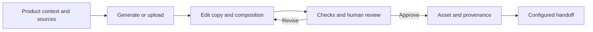

# Relay Asset Studio

**AI creative systems · Ecommerce production · Human review**

A creative production workflow that keeps product context, generated imagery, editable composition, approval, and asset history together.

**My role:** product and workflow design, creative controls, application development, AI integration, evaluation design, and operating documentation.

[Published Asset Studio case study](https://saraward.ai/asset-studio) · [Validation evidence](docs/validation.md) · [Sara Ward](https://saraward.ai)

## The production problem

An image generator handles only one step in campaign production. The operator still needs the right product source, accurate copy, editable typography, appropriate dimensions, a review decision, and a usable destination. Moving between disconnected tools loses the context behind the final file.

Asset Studio brings those decisions into a guided workspace: select collection context, choose or upload a source, generate when useful, finish the composition, review it, and preserve the approved version with its metadata.

## What I built and designed

- A workflow connecting commerce context, creative sources, generation, editing, review, and reuse.
- Human control over source selection, copy, crop, scale, layout, rejection, and final approval.
- Separate source imagery and finished compositions, with metadata describing their relationship.
- An independent Node.js service with its own owner access, asset storage, workflow records, and evaluation records.
- Explicit boundaries between the internal production application and independent product development.

## AI, code, and people

| Responsibility | Owner | Why |
| --- | --- | --- |
| Generate image and copy candidates | AI assistance | Produces options within the creative brief |
| Check required structure, storage boundaries, and workflow state | Deterministic code | Repeatable constraints need predictable enforcement |
| Assess product fidelity and creative suitability | Human review; evaluation research supports the independent workflow | A successful generation request does not establish that an asset is usable |
| Approve a finished version | Human operator | Release is an explicit creative decision |
| Preserve asset history and evaluation records | Application services | Future reuse needs context and traceability |

## Implementation status

Two implementations provide different evidence:

| Implementation | Evidence and limits |
| --- | --- |
| **Internal Asset Studio** | The published case study documents a deployed creative workspace with Collections, Designer, Asset Repo, metadata, and human approval. It explicitly reports that the automated image evaluator was removed. |
| **Independent Relay Asset Studio** | Working local Node.js service with separate storage and evaluation records. Six existing service checks passed on September 15, 2026. Dedicated production deployment is still pending. External campaign writes are disconnected. |

The local service tests cover software boundaries and record creation. They do not establish production deployment, image-evaluation accuracy, campaign performance, or time savings. See the [validation record](docs/validation.md) for the exact scope.

## What this demonstrates

Creative production knowledge translated into application behavior; AI used within a larger workflow; explicit human decisions; and careful separation of product intent, implementation status, and test evidence.

This repository is a public case study. It contains no production source, client records, operational credentials, or proprietary generation recipes.
