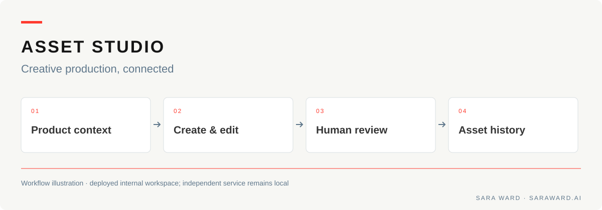
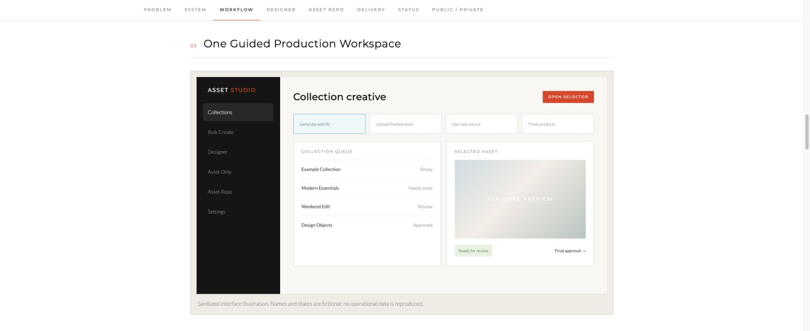

# Relay Asset Studio

A creative workspace connecting product context, AI-generated imagery, editable layouts, human review, and asset history.

[Visual case study](https://saraward.ai/asset-studio) · [Technical evidence](docs/validation.md) · [Portfolio](https://saraward.ai)

## At a glance

- **For:** creative and ecommerce teams moving between product sources, image tools, layout edits, and approvals.
- **My contribution:** product and workflow design, application development, AI integration, creative controls, and operating documentation.
- **What this demonstrates:** translating a creative production process into an editable application with explicit review and asset history.
- **Evidence:** [visual case study](https://saraward.ai/asset-studio) and [implementation / validation notes](docs/validation.md).

**Status:** the internal creative workspace is deployed. The separate independent Relay service works locally; production deployment is pending. No efficiency, adoption, or revenue metric is claimed here.

## See the workflow

*Screenshot of the existing public case-study illustration. Names and states are fictional; no operational data is shown.*

## The problem

Generating an image is one step in campaign production. Someone still has to find the right product source, write accurate copy, adjust the layout, review the result, and save a usable asset. Moving between disconnected tools loses the context behind that final file.

## What I built

- Product context and source selection connected to generation or upload.
- Editable copy, typography, crop, scale, and composition.
- Human review with the ability to revise, reject, or approve.
- Asset storage and metadata connecting source imagery to finished work.

**My role:** product and workflow design, application development, AI integration, creative controls, evaluation design, and operating documentation.

## Implementation

| System | Current status |
| --- | --- |
| Internal Asset Studio | Deployed creative workspace with Collections, Designer, Asset Repo, metadata, and human approval |
| Independent Relay service | Working local Node.js service with separate owner access, storage, and evaluation records; production deployment pending |

The independent service has six documented passing service checks. [Technical evidence](docs/validation.md) explains what they cover and how the two implementations differ.

This repository is a public case study; application source and client configuration remain private.
